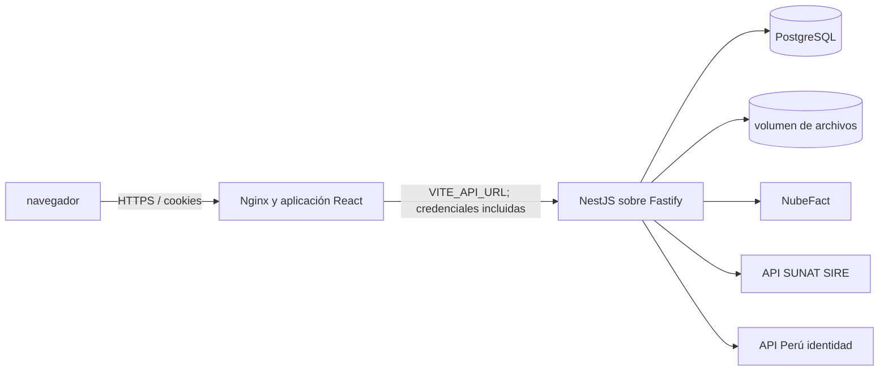

# Inversiones Maguiña

Sistema web de gestión comercial con frontend React, API NestJS/Fastify y persistencia PostgreSQL mediante Drizzle ORM. Este README se reconstruye desde los archivos de código y configuración del commit de trabajo; no certifica la disponibilidad del entorno productivo.

## Alcance visible en el código

El monorepositorio contiene aplicaciones web y API, y un paquete de base de datos. La API agrupa autenticación, personas, almacenamiento, inventario/SIRE, ingresos y facturación, reportes, egresos, mototaxis y finanzas. La web registra rutas de acceso para áreas de compras, ventas, inventario, reportes y personas; varias rutas montan un punto de entrada común, por lo que su presencia no demuestra por sí sola el flujo completo.

## Arquitectura y tecnología

- Workspace pnpm 10.20.0 y tareas coordinadas con Turborepo.
- Node.js >=22; React 19 y Vite 7 en `apps/web`.
- NestJS 11 sobre Fastify 5 en `apps/api`.
- PostgreSQL 16 en Compose y Drizzle ORM en `packages/database`.
- Dockerfiles separados para web, API y operaciones/migraciones.



## Requisitos e inicio local

Requisitos declarados: Node.js 22 o superior, Corepack/pnpm 10.20.0 y PostgreSQL accesible. Docker Desktop sirve para los perfiles Compose. En Windows, los comandos se ejecutan desde PowerShell en la raíz:

```powershell
corepack enable
corepack prepare pnpm@10.20.0 --activate
Copy-Item .env.example .env
docker compose up -d
```

Complete en `.env` las variables que valida la API (ver [variables](docs/10-variables-de-entorno.md)); luego:

```powershell
corepack pnpm install --frozen-lockfile
corepack pnpm --filter @magina/database db:migrate
corepack pnpm dev
```

La API requiere `DATABASE_URL`, `FRONTEND_ORIGIN`, `AUTENTICACION_SECRETO`, `NUBEFACT_RUTA` HTTPS y `NUBEFACT_TOKEN` al iniciar. Por eso el arranque real depende de configurar integraciones, incluso si solo se desea probar pantallas; consulte [desarrollo local](docs/03-instalacion-y-desarrollo-local.md).

## Comprobaciones disponibles

`pnpm build`, `pnpm typecheck`, suites API (unitarias, integración PostgreSQL, API HTTP y seguridad) y Playwright E2E están declaradas. No se ejecutaron durante esta reconstrucción; los resultados de CI son evidencia por commit, no prueba de este entorno. Consulte [pruebas](docs/12-pruebas-y-calidad.md).

## Docker y despliegue

Hay Compose para desarrollo, pruebas, integración y producción. Producción define PostgreSQL, tarea de migración, API y web; requiere red externa `dokploy-network`, imágenes GHCR por SHA completo y variables de despliegue. GitHub Actions publica imágenes y tiene un job Dokploy condicionado a variables/repositorio y secretos. No se verificó acceso al proveedor ni publicación desde este checkout. Véase [Docker](docs/11-docker-y-contenedores.md), [CI/CD](docs/13-integracion-y-despliegue-continuo.md) y [Dokploy](docs/14-despliegue-en-dokploy.md).

## Estado de verificación

La documentación distingue código presente, pruebas declaradas y comportamiento ejecutado. Varias reglas comerciales, recuperación de respaldos, conectividad con proveedores y rutas funcionales necesitan validación funcional. Empiece por el [índice documental](docs/README.md) y revise la [matriz](docs/19-matriz-de-funcionalidades.md).

## Documentación detallada

- [01 Arquitectura general](docs/01-arquitectura-general.md)
- [02 Estructura del monorepositorio](docs/02-estructura-del-monorepositorio.md)
- [03 Instalación y desarrollo local](docs/03-instalacion-y-desarrollo-local.md)
- [04 Backend y API](docs/04-backend-y-api.md)
- [05 Frontend](docs/05-frontend.md)
- [06 Modelo de datos](docs/06-modelo-de-datos.md)
- [Catálogo de datos generado desde Drizzle](docs/catalogo-de-datos.md)
- [07 Módulos y reglas de negocio](docs/07-modulos-y-reglas-de-negocio.md)
- [08 Autenticación y permisos](docs/08-autenticacion-y-permisos.md)
- [09 Integraciones externas](docs/09-integraciones-externas.md)
- [10 Variables de entorno](docs/10-variables-de-entorno.md)
- [11 Docker y contenedores](docs/11-docker-y-contenedores.md)
- [12 Pruebas y calidad](docs/12-pruebas-y-calidad.md)
- [13 Integración y despliegue continuo](docs/13-integracion-y-despliegue-continuo.md)
- [14 Despliegue en Dokploy](docs/14-despliegue-en-dokploy.md)
- [15 Respaldo y restauración](docs/15-respaldo-y-restauracion.md)
- [16 Seguridad](docs/16-seguridad.md)
- [17 Operación y monitoreo](docs/17-operacion-y-monitoreo.md)
- [18 Solución de problemas](docs/18-solucion-de-problemas.md)
- [19 Matriz de funcionalidades](docs/19-matriz-de-funcionalidades.md)
- [20 Proceso de versiones](docs/20-proceso-de-versiones.md)
