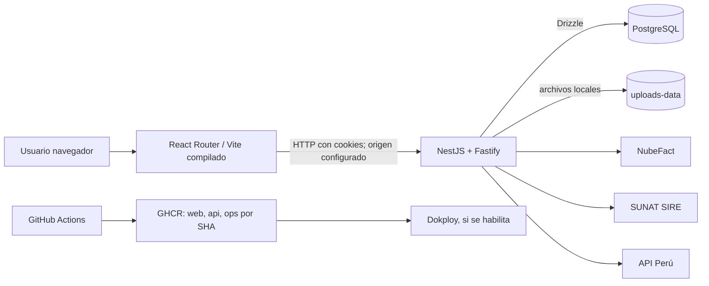

# 01. Arquitectura general

**Propósito y alcance:** describir los componentes encontrados en el repositorio. **Verificación:** estática; servicios externos y producción no se probaron.

Monorepositorio TypeScript con frontend SPA, API modular y biblioteca de acceso/esquema PostgreSQL. La API se inicia con NestFactory y FastifyAdapter; registra cookies y multipart, aplica CORS con credenciales y escucha en `0.0.0.0`. El frontend sirve la aplicación compilada detrás de Nginx en el contenedor productivo. La API sirve salud en `/health` y verifica `select 1` en la base.

La autenticación HTTP usa cookie y JWT según módulos de autenticación; las operaciones protegidas aplican `GuardiaSesion` y `GuardiaPermiso`. No se encontró evidencia de colas/workers en los manifiestos revisados. El almacenamiento compartido se configura mediante `UPLOADS_DIR` y volumen en Compose. Las decisiones de red y despliegue se detallan en [Docker](11-docker-y-contenedores.md).

**Fuentes:** `apps/api/src/main.ts`, `modulo-aplicacion.ts`, `modulos/*`, `apps/web/src/main/main.tsx`, `docker/*.Dockerfile`, `compose.prod.yaml`, workflow de GitHub.

**Limitaciones:** no se midió latencia, disponibilidad, topología desplegada ni comportamiento autenticado en navegador.
