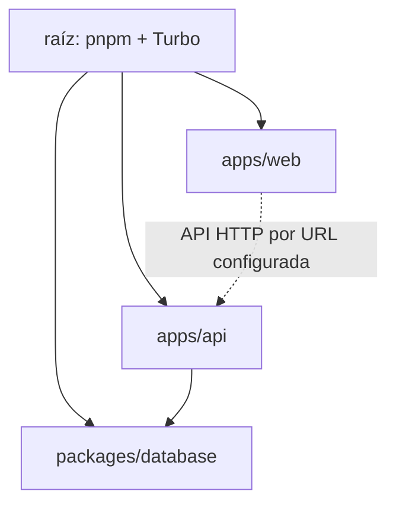

# 02. Estructura del monorepositorio

**Propósito:** localizar aplicaciones y paquetes. **Verificación:** manifiestos y estructura presentes; responsabilidad inferida únicamente de nombres/importaciones.

| Ruta | Rol comprobado |
|---|---|
| `apps/api` | Aplicación NestJS/Fastify, módulos, pruebas y comando administrativo |
| `apps/web` | Aplicación React 19 con Vite y React Router |
| `packages/database` | Cliente PostgreSQL, esquema Drizzle y migraciones |
| `docker` | Dockerfiles, configuración Nginx y encabezados |
| raíz `compose*.yaml` | Perfiles de ejecución Docker |
| `.github/workflows` | CI, publicación y despliegue condicionado |

`pnpm-workspace.yaml` incluye `apps/*` y `packages/*`. Dependencia interna observada: API → `@magina/database`. Turborepo coordina `dev`, `build`, `typecheck` y pruebas; las tareas de tipo/build esperan dependencias de workspace.

**Fuentes:** `pnpm-workspace.yaml`, `turbo.json` y `package.json` de cada workspace. **Limitación:** no se infiere dependencia directa entre web y API como paquete; se comunican por HTTP.
