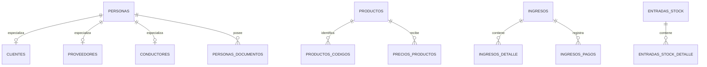

# 06. Modelo de datos

**Propósito:** orientar el esquema PostgreSQL. **Estado:** estático; no se comparó contra una instancia activa.

`packages/database/src/esquema/index.ts` declara 59 tablas Drizzle. La cadena versionada contiene 170 archivos SQL (`0000`–`0169`); `drizzle.config.ts` configura migraciones y `db:migrate` aplica el journal. CI ejecuta migraciones dos veces sobre PostgreSQL vacío, pero no se ejecutó aquí ni demuestra equivalencia de una base ya existente.

El [catálogo de datos generado](catalogo-de-datos.md) enumera tablas, columnas, constructor Drizzle, nulabilidad, presencia de defaults, referencias `references()` y nombres de índices/checks declarados en los builders. No expande longitudes/precisiones ni miembros de índices compuestos; esa revisión debe hacerse en el esquema fuente y las migraciones.

Grupos observados: personas y roles/permisos; catálogo, marcas, unidades, precios y códigos; entradas y movimientos de stock; ingresos, detalle, pagos, documentos relacionados y notas; egresos/documentos recibidos/pagos; mototaxis, compras, unidades, movimientos y garantías; cuentas financieras; archivos locales e imágenes; órdenes de servicio, cotizaciones, guías y series/correlativos.

Diagrama parcial: relaciones ilustradas corresponden a claves del esquema, no al catálogo entero. Campos monetarios usan `numeric`; fechas y timestamps se declaran explícitamente en esquema. Consulte `index.ts` para tipo, nulabilidad, defaults, índices, checks y FK por columna. Divergencias entre esquema y migraciones requieren comparar el estado de una base creada desde cero y la instancia destino; no se presume drift.

**Fuentes:** paquete database, migraciones SQL y job CI “Aplicar todas las migraciones sobre PostgreSQL vacío”. **Limitaciones:** documentación tabla/campo exhaustiva y diff ejecutado pendientes.
