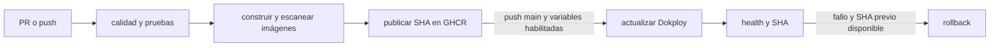

# 13. Integración y despliegue continuo

**Propósito:** reflejar `.github/workflows/pipeline.yml`. **Estado:** configuración inspeccionada; estado de ejecuciones requiere GitHub.

El pipeline se activa en PR a `main` o `feature/docker-cicd-production`, y push a `main` o `test/quality-gates-e2e`. El job de calidad instala Node 22/pnpm 10.20.0, valida formato, typecheck/build, migra dos veces PostgreSQL limpio, corre unitarias/integración/API/seguridad/E2E/cobertura y auditoría de dependencias. El job de imágenes construye y escanea API/ops/web; publica tags GHCR por SHA después de las compuertas.

El job `deploy` se ejecuta solo en push a `main` y si `PRODUCTION_DEPLOY_ENABLED == true` y `DOKPLOY_ENV_UPDATE_ATOMIC_VERIFIED == true`. Usa secretos de Dokploy, ejecuta script de actualización, comprueba SHA en salud API y `build-info.json`; si falla el humo y hay SHA previo, intenta rollback y vuelve a comprobar.

**Fuentes:** workflow y `.github/scripts/deploy-dokploy.mjs`. **Limitaciones:** staging no está identificado como ambiente configurado en el workflow; no afirmar política de ramas/release distinta de triggers observados.
