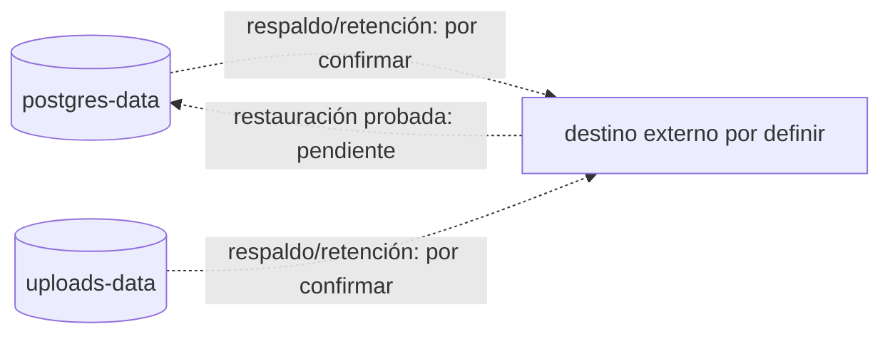

# 15. Respaldo y restauración

**Propósito:** registrar persistencia visible y límites de evidencia. **Estado:** no hay procedimiento de backup/restore verificado en los archivos examinados.

Compose productivo persiste PostgreSQL en `postgres-data` y archivos cargados en `uploads-data`; el API usa `UPLOADS_DIR=/data/uploads`. Ambos volúmenes son datos operativos importantes. Los workflows revisados no contienen job de respaldo con calendario, retención, cifrado ni restauración. No afirmar que Dokploy, Hostinger u otro proveedor los respalda sin prueba/configuración del servicio.

Procedimiento de restauración, frecuencia, cifrado, verificación y RPO/RTO: **REQUIERE VALIDACIÓN OPERATIVA**. Como recomendación, establecer respaldos coherentes de DB y archivos, cifrar fuera del host y probar recuperación aislada antes de prometer continuidad. La recomendación no describe una capacidad ya implementada.

**Fuentes:** `compose.prod.yaml`, `almacenamiento.service.ts`, `UPLOADS_DIR`. **Limitación crítica:** no ejecutar restauración ni declarar recuperabilidad hasta tener artefacto y ensayo documentados.
