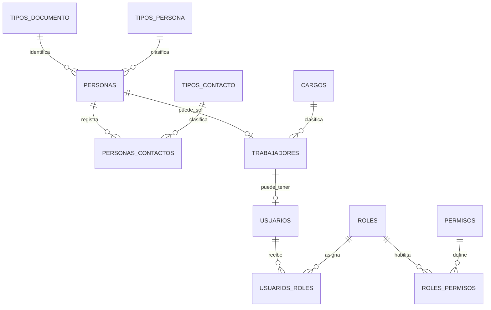

# Personas, trabajadores y acceso

La estructura sigue el patrón modular usado en VAPETRA, adaptado a PostgreSQL + Drizzle y a la tienda de motos y repuestos.



## Tablas

- `tipos_persona`: catálogo de persona natural y persona jurídica.
- `personas`: documento único por tipo, nombres/apellidos o razón social; el tipo se referencia al catálogo `tipos_persona`.
- `tipos_documento`: DNI, carné de extranjería, RUC y pasaporte. La longitud y el formato se validan en la capa de aplicación.
- `tipos_contacto` y `personas_contactos`: correo, teléfonos, WhatsApp, sitio web u otros; permite marcar un contacto principal por tipo.
- `trabajadores` y `cargos`: datos laborales separados de la identidad personal. La fecha de cese no puede preceder a la fecha de ingreso.
- `usuarios`: cuenta asociada a un trabajador, nombre de usuario y correo únicos sin distinguir mayúsculas, hash de contraseña, estado y cambio obligatorio de clave.
- `roles` y `usuarios_roles`: asignación de roles a las cuentas.
- `permisos` y `roles_permisos`: permisos por módulo y acción, asignables a roles.

La migración inicial crea seis roles de referencia y catorce permisos para personas, trabajadores, usuarios y roles. Solo el rol Administrador recibe permisos inicialmente; los demás roles quedan sin permisos hasta definirlos para cada puesto. No se creó una cuenta de usuario ni se inventaron credenciales.

## Migraciones

Desde la raíz del monorepo:

```bash
corepack pnpm --filter @magina/database db:generate
corepack pnpm --filter @magina/database db:migrate
```

La base local corre en Docker (`localhost:5433`).
